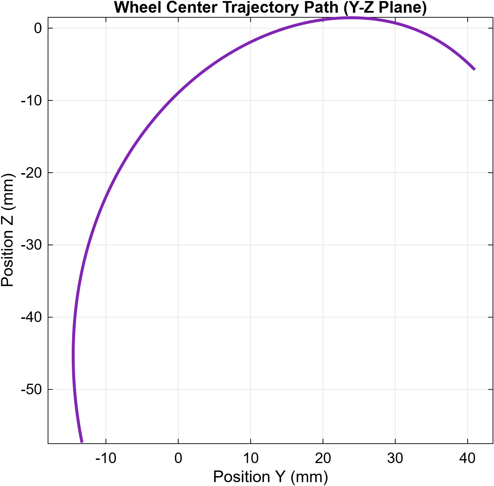
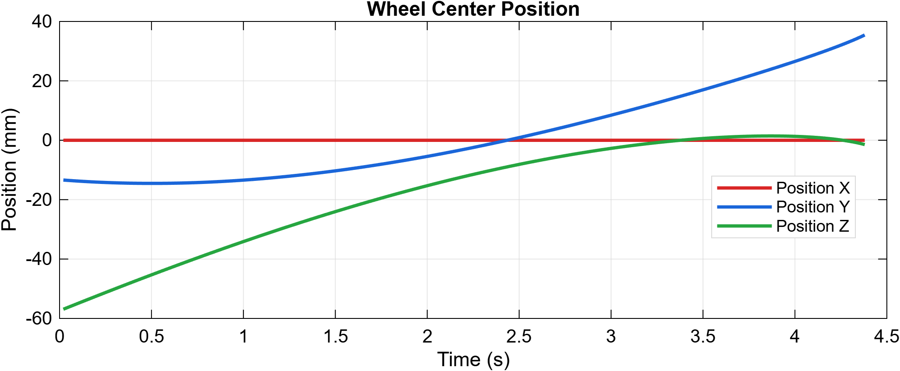
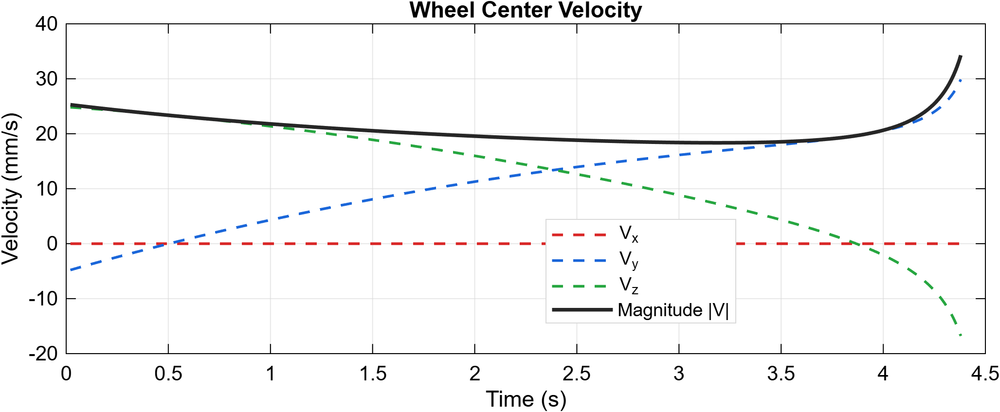
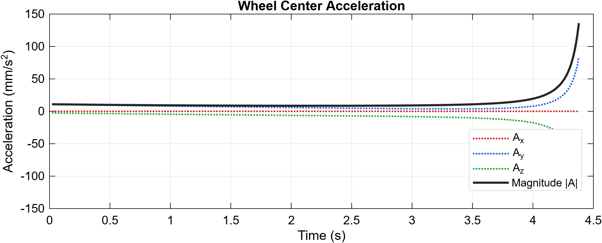

# Simulation

โฟลเดอร์นี้รวบรวมไฟล์แบบจำลอง 3 มิติ (CAD Assembly & Parts), ไฟล์แบบจำลองทางพลศาสตร์ (Simscape Multibody) และกราฟผลลัพธ์จากการจำลองการเคลื่อนที่ของกลไกพับล้อเครื่องบิน

---

## 1. Directory & File Structure 
* **`Landing_Gear_Simscape_multibody.slx`** – ไฟล์โมเดลใน Simulink / Simscape Multibody สำหรับจำลองการเคลื่อนที่และเก็บข้อมูล Kinematics ของจุดศูนย์กลางล้อ
* **`Landing_Gear_Simscape_Matlab.m`** – สคริปต์ MATLAB สำหรับดึงข้อมูลจาก Workspace และสร้างกราฟ
* **Output Plots:** `Wheel_Trajectory.png`, `Wheel_Position.png`, `Wheel_Velocity.png`, `Wheel_Acceleration.png` – กราฟแสดงเส้นทางการเคลื่อนที่ ตำแหน่ง ความเร็ว และความเร่งของจุดศูนย์กลางล้อ ($t = \text{ s}$ ถึง $4.5\text{ s}$)
* **`cad/`** – โฟลเดอร์เก็บไฟล์ชิ้นงาน 3 มิติต้นฉบับ:
  * `Landing Gear mechanism assembly.f3d` – ไฟล์ประกอบชิ้นส่วนต้นฉบับ (Autodesk Fusion)
  * `Landing Gear assembly.iam` – ไฟล์ประกอบชิ้นส่วน (Autodesk Inventor)
  * `Landing Gear assembly.step` – ไฟล์ประกอบชิ้นส่วนมาตรฐาน (STEP Format)
  * **`Parts/`** – ไฟล์ชิ้นส่วนย่อย (`.step`) ที่แยกออกจากกันสำหรับนำเข้าบล็อก `File Solid` ใน Simscape ประกอบด้วย:
    * โครงสร้างและแขนกลไก: `Base.step`, `Purple.step`, `Orange.step`, `Red.step`, `Yellow.step`, `Light green.step`, `Dark green.step`, `extragreen.step`
    * ชุดกระบอกสูบและล้อ: `Upper_Piston1.step`, `Lower_Piston2.step`, `Wheel.step`
    * สลักจุดหมุน (Pins): `D0493-030.step` ถึง `D0493-041.step`

---

## 2. Software
* **CAD Modeling:** Autodesk Fusion / Autodesk Inventor
* **Multibody Simulation:** MATLAB & Simulink 
* **Required Toolboxes:**
  * Simscape
  * Simscape Multibody

---

## 3. Simulation Assumptions, Boundary Conditions & Material Properties
* **Assumptions (สมมติฐาน):**
  * ชิ้นส่วนกลไกทุกชิ้นถือเป็น **วัตถุแข็งเกร็ง (Rigid Bodies)** ไม่มีการเสียรูปจากแรงกระทำ
  * จุดหมุนทั้งหมดเป็น **ข้อต่ออุดมคติ (Ideal Frictionless Joints)** ไม่คิดแรงเสียดทานและระยะคลอน (Clearance)
* **Boundary Conditions (เงื่อนไขขอบเขต):**
  * **Ground Frame:** ชิ้นส่วน `Base.step` ถูกยึดตรึงกับ World Frame ด้วย `Weld Joint`
  * **Actuation Input (1-DoF):** ป้อนสัญญาณการหมุนขับเคลื่อนที่ข้อต่อของ `Purple.step` ผ่านบล็อก `Repeating Sequence` (ช่วงเวลาพับล้อ $t = 0\text{ s}$ ถึง $4.5\text{ s}$)
  * **Sensors:** ติดตั้ง `Transform Sensor` ที่จุดศูนย์กลางของ `Wheel.step` เทียบกับ World Frame เพื่อบันทึกค่า `x_wheel`, `v_wheel` และ `a_wheel` ลงใน Workspace
* **Material Properties (คุณสมบัติวัสดุ):**
  * กำหนดความหนาแน่นสม่ำเสมอ (Uniform Density) ให้กับชิ้นส่วน `File Solid` ทุกชิ้นเพื่อให้โปรแกรมคำนวณมวลและโมเมนต์ความเฉื่อย อัตโนมัติจากปริมาตร CAD

---

## 4. Simulation Output Preview

| Trajectory Path (Y-Z Plane) | Position vs Time |
| :---: | :---: |
|  |  |

| Velocity vs Time | Acceleration vs Time |
| :---: | :---: |
|  |  |